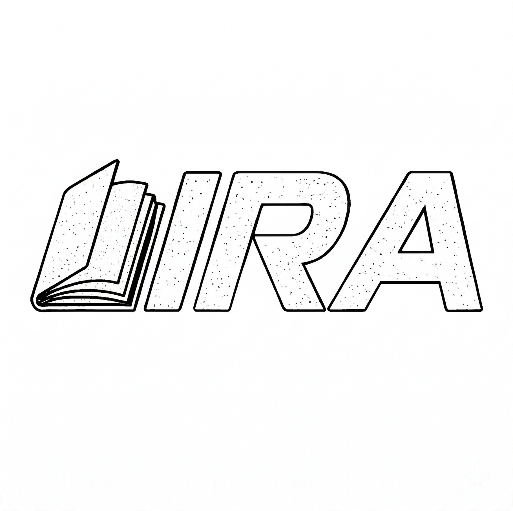

<div align="center">



# Lira

_A desktop agent that writes Orton-Gillingham lesson plans for dyslexia tutors, built on Block's open source goose._

</div>

Lira is a fork of [goose](https://github.com/aaif-goose/goose) (Rust agent core, Electron and React desktop app). It keeps goose's agent loop, providers and ACP, and replaces everything a tutor sees and everything the model is told.

The hard part of the problem is one rule: **every word in a student's materials must be readable using only the sounds and sight words that student already knows.** One unknown pattern in a sentence ("sat *down*", "a *cart*") breaks the lesson. Lira treats this as a constraint satisfaction task and checks it twice before it hands a plan back.

## What a tutor does

1. Pick a student. Each student is a folder: a profile, `sounds.md`, `sight-words.md`, and a `lesson-plans/` history.
2. Ask for the next lesson.
3. Lira reads the profile, the known sound flags and the last three plans, writes the plan, and runs a decodability pass and a meaning pass over it.
4. Export to PDF.

Tool calls and thinking blocks are hidden from the conversation by default, and a progress line ("Checking sight words…") shows what is happening in plain language.

## What was built on top of goose

| Area | What changed |
| --- | --- |
| Prompting | Split system prompt and a lesson planning guide written with dyslexia specialists. Rules are numbered and labeled so smaller models follow them reliably. |
| Student workspace | Student picker, workspace scaffolding, and a files panel for each chat in place of the open chat hub. |
| UI for tutors | Tool calls and thinking hidden behind a setting. Navigation trimmed. Wordmark loader. |
| Progress messages | The Rust agent maps a tool call's file path to a friendly phrase and sends it over goose's existing ACP progress channel, so internal tool names never reach the UI. |
| Export | LaTeX template and script that render a plan onto a lesson form. |
| Packaging | `lira://` protocol, bundle id, and automatic updates pointed at this fork. |
| Cost tooling | A batch script and CSV schema for comparing models on cost, rating and thinking effort. |

[LIRA.md](LIRA.md) lists the files and commits behind each row.

## Measured results

These are from one paired run on one student, so treat them as indicative, not a benchmark.

- Trimming the lesson planning guide cut it from about 6,400 to about 2,500 tokens (62%) while keeping every rule.
- With the same model and student, a full lesson plan took 402s with the trimmed guide against 635s with the original, and 8 agent turns against 17.
- The default thinking effort setting gives Anthropic models a budget of 16k tokens per turn. Most turns are file reads and edits that gain nothing from it.

## Try the format without the app

[`examples/lira-demo`](examples/lira-demo) holds a fictional student and an abbreviated sample plan, so you can see what the model reads and what it produces.

## Build and run

You need the Rust toolchain from `rust-toolchain.toml`, Node 24, and pnpm.

```bash
cargo build --release -p goose-cli --bin goose
cp target/release/goose ui/desktop/src/bin/goose
cd ui/desktop && pnpm install && pnpm run start-gui
```

You also need an API key for at least one provider, set in the app.

Toolchain notes from getting this running on a fresh machine:

- Node 22 is too old for the workspace. Use Node 24.10 or newer.
- If corepack fails with "Cannot find matching keyid", run with `COREPACK_INTEGRITY_KEYS=0`.
- Run `corepack enable` so nested install scripts can find `pnpm`, and set `CI=true` when pnpm needs to run without a TTY.
- The Rust release build takes about ten minutes on a cold cache.

## Credit and license

Lira is built on goose, created by Block and now part of the Agentic AI Foundation, and is released under the same Apache 2.0 license. The original README is kept at [docs/UPSTREAM_README.md](docs/UPSTREAM_README.md). Lira is an independent project and is not affiliated with or endorsed by Block.
